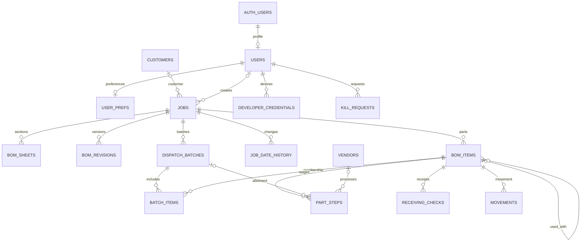

# Mould Job Tracker — Supabase schema

This is the Phase 1 foundation specified in section 8 of `MOULD_JOB_TRACKER_FINAL_PLAN.md`. It covers the four roles, moulds, BOMs, receiving, planning, vendor work, history and settings. The complete executable schema is `supabase/schema.sql`; versioned migrations remain the source of truth. See IMPLEMENTATION_STATUS.md for the operational screens and verification evidence.

## Which SQL should I run?

- **Existing Mapel Project (`emrjfelkxbegkvyxszba`):** eleven source migrations have been applied on 3–4 November 2026. Do not run the consolidated installer on it. Only reviewed, pending migrations are applied to the hosted project.
- **New empty Supabase project:** preferably apply `supabase/migrations` using the existing Management API script or Supabase CLI. Alternatively, open SQL Editor, paste the entire `supabase/schema.sql` file and run it as the database owner.
- **Existing tables or partially installed schema:** use reviewed, pending versioned migrations. The consolidated installer deliberately stops before changes if public tables, application enum types or the private helper schema exist.

The installer is one transaction: an error prevents a partially installed schema. It has no destructive reset commands. It does not contain credentials or customer data. Supabase supplies `auth.users`, `storage.buckets` and `storage.objects`; it is not a standalone PostgreSQL installer.

The SQL Editor installer does not populate Supabase migration history. Do not subsequently push all migrations as if they were unapplied; establish the matching baseline first. The CLI/Management API migration route already handles history and is preferred.

## Table guide

| Table | Purpose and main links |
| --- | --- |
| `users` | Profile linked to `auth.users.id`; developer/admin/operator/viewer role, active flag, language. Developer profiles are hidden from other roles. |
| `user_prefs` | User-owned language preference: en, hi, mr. |
| `customers` | Customer name and code. |
| `jobs` | One mould identified by a unique mould code; customer, T0 date, status and priority. |
| `job_date_history` | Append-only date/priority change history with reason and actor; linked to a job. |
| `bom_sheets` | Per-job section and sign-off metadata; source file reference and revision number. |
| `bom_revisions` | Append-only BOM snapshot/revision history per job. |
| `bom_items` | Per-job base/child/turn/hardware parts, raw and parsed dimensions, quantity, drawing and 2D submission flag; optional hardware-to-part link. |
| `step_templates` | Database-configured steps by category and duration. Turning/Hardening/Grinding seed to 4/2/3 days. Squaring/Machining durations are undecided (NULL). |
| `material_routes` | Ordered manufacturing steps per material. Category-specific routes will need explicit extension when the planning phase is implemented. |
| `vendors` | Saved job-work vendor details. |
| `dispatch_batches` | In-house or outsourced batch under a mould, with actual sent date. |
| `batch_items` | Batch membership and partial sent/returned quantities. |
| `part_steps` | Per-part stage, vendor, status, planned/started/done/target dates and batch. |
| `receiving_checks` | Expected/found quantities, ok/short/excess/wrong result and checking user. |
| `movements` | Part movements and quantities between physical destinations; dispatch/return dates. |
| `remarks` | Append-only manual, alert, delay and information entries. `entity_type` + `entity_id` are polymorphic references, not enforced foreign keys. |
| `holidays` | Dates excluded from working-day calculations. Sundays are also excluded by scheduling logic. |
| `settings` | JSON configuration such as extraction provider and alert window. No provider secrets belong here. |
| `developer_credentials` | Public WebAuthn credentials for the later developer panel; client writes disabled until server verification exists. |
| `kill_requests` | Later-phase wipe request records; no client write policy or wipe implementation in Phase 1. |
| `stage_returns` | Immutable quantity events with partial returns and signed Undo entries; linked to a part stage. |
| `mould_events` | Immutable assembly, T0/T1/T2, correction, Finish/Reopen and Undo events. Physical work fingerprints invalidate stale assembly/trials. |
| `audit_log` | Immutable old/new values, action, actor and time, populated by triggers on all 23 other tables. |

Every table includes `archived_at`. Operational records are soft-deleted by setting that timestamp. History tables remain append-only even though the common column is present; callers cannot archive away history. Active-list queries must filter `archived_at IS NULL`; privileged history queries may include archived rows. No app API role can hard-delete or truncate public tables.

## Relationships

The diagram shows principal foreign keys. Templates, material routes, holidays and settings are lookup/configuration tables. Remarks and audit entries retain their references without requiring the target record to remain visible.

## Access and safety

| Role | Operational records | Master settings | User management | Full audit log |
| --- | --- | --- | --- | --- |
| Developer | Read/create/update/archive | Read/write | All roles | Read |
| Admin | Read/create/update/archive | Read/write | Operators/viewers only | No |
| Operator | Read/create/update/archive | Read configuration for workflows; no writes | Own profile read only | No |
| Viewer | Read only | Read configuration for display; no writes | Own profile read only | No |

All roles can change only their own `user_prefs`. No active application profile means no application data access. Role lookup is database-backed, so disabling a profile immediately affects subsequent queries even when its Auth token still exists. The helper and privileged audit function live in unexposed `app_private`; the views use `security_invoker=true` to preserve RLS.

Private Storage bucket `bom-sources` allows authenticated readers and operator/admin/developer uploads only for an active mould. Object names start with the job UUID. Files are limited to 10 MB and the allowed image/PDF/XLSX MIME types. Original objects cannot be overwritten or deleted by ordinary app clients; use new keys for revisions.

A part cannot join a batch from another mould. Hardware cannot be planned or allotted to vendors. `qty_back` cannot exceed `qty_sent`. History and audit rows cannot be edited or deleted.

## Views and status values

- `readiness`: parts_total and parts_ready per active/non-deleted job. Unplanned parts count as waiting. Parts with all recorded steps NOT APPLICABLE are excluded. A part is ready only if every applicable recorded step is DONE.
- `criticality`: adds T0 and the readiness ratio. Query active moulds and order by readiness ascending NULLS FIRST, then T0 ascending NULLS LAST. On-hold jobs must be filtered out by the dashboard query; the view retains them for other screens.
- Database stage statuses map to UI words: `PENDING` → Waiting; `IN PROCESS` → Working; `DONE` → Done; `DELAY` → Late; `NOT APPLICABLE` → Not needed.

## Receipt and scheduling safeguards

- Mould changes require a reason in the database. Prior values are appended to job_date_history. Unstarted target dates move in working days; deadlines for already-started work remain unchanged.
- Reviewed BOM imports are atomic and retry-safe. Revisions retain progress. Quantity changes after processing/allotment or hardware issue are blocked; extra units should be added as a new row.
- Receipts use caller-level public RPC wrappers with role-checked private writer functions. Authenticated clients cannot directly insert/update the receipt journal. Partial/excess/wrong receipts, corrections and Undo retain the original history and audit actor.
- Hardware must be fully received and verified before issue. It has no vendor allotment or machining route.
- History can resolve actor names without exposing the users directory, phone numbers or roles.

## Remaining limits

Mould-level assembly and T0/T1/T2 history are in `mould_events`. Caller-level public RPC wrappers invoke role-checked private helpers; direct ledger writes are revoked. Finished requires ready parts, current assembly, explicit trial outcomes, a passing retest after corrections, and no outstanding corrections. T0 is required; T1/T2 can be explicitly Not needed with a reason after a pass. Reopening requires a reason. No purchasing, purchase order, customer-dispatch or gate-pass tables exist. Sunday/holiday-aware working dates use configured durations and the actual sent date. A private alert worker is scheduled through built-in pg_cron at 01:00 India time when available; the installer preserves a conflicting existing job. The hosted schedule and a manual run are verified; the first nightly run is still pending.

The external nightly backup workflow is separate from this SQL. A separate account, upload-only credentials, retention and a restore drill are still required. Installing tables does not activate backups. PINs are handled by Supabase Auth as password hashes; never add a plaintext PIN column to `public.users`.

## Regenerate and verify

Run `npm run schema:build` after adding a reviewed migration. The generator writes `supabase/schema.sql` and `supabase/schema-manifest.json`, containing source filenames and SHA-256 hashes. Run `npm test` to verify both role policies and the fresh-project installer. These local PostgreSQL tests emulate Supabase Auth/Storage schemas; they do not provision a new hosted project.
